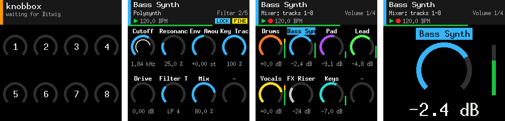

# ST7789 1.54″ 240×240 IPS colour screen (Hosyond)

**Role in knobbox:** the box's screen: each knob's parameter name, value and position, plus
the track, device and page (added 2026-11-11; `firmware/src/display.rs`, `logic/src/screen.rs`).
**On hand:** Hosyond "1.54 inch IPS TFT LCD Display Module 240x240 ST7789 SPI 3.3V", pack of
3. Board marked `1.54TFT-SPI-ST7789 Ver:1.1`, blue, 4 corner mounting holes. Format copied
from an earlier project's component cards.

| Field | Value | Status |
|---|---|---|
| Panel | 1.54″ IPS, 240 × 240, colour (RGB565, 16 bits a pixel); **active area 27.72 × 27.72** | listing (product description) |
| Driver | ST7789 | listing; board silkscreen |
| Interface | 4-wire SPI (clock, data, D/C, CS), write only (no MISO pin). The ST7789 takes a write clock down to a 16 ns cycle, about 62.5 MHz, which is also the RP2040's SPI maximum at the default 125 MHz system clock | listing; ST7789 datasheet (write cycle), RP2040 datasheet (SPI ≤ clk_peri / 2) |
| Supply | **3.3 V**; 0.265 W listed. U7 is a SOT-223 part, likely a regulator, so VCC may also take 5 V, but that isn't stated: feed 3.3 V | listing (product description); U7 role UNVERIFIED |
| Logic level | 3.3 V, same as the Pico | listing |
| Backlight | `BL` pin, probably through the transistor U9. High = on. Tie to 3.3 V, or a GPIO for PWM dimming. **LED current 45.1 mA** (from the 3.3 V supply; the Pico's 3V3 OUT gives up to 300 mA) | listing (product description) |
| Board size | **PCB 32.00 × 43.72**, header along a 32 mm edge, Ø~3 hole in each corner (positions not given). The glass (CHECK 31.5 × 33.7, about 1.8 thick, the usual 1.54″ panel) sits on the front with its flex cable folded onto the PCB at the end away from the header | listing (PCB size); glass and holes UNVERIFIED |

## Pins

Left to right with the glass facing you and the header at the top.

| Pin | Function | Notes |
|---|---|---|
| GND | ground | |
| VCC | 3.3 V | |
| SCL | **SPI clock** (not I2C, despite the name) | |
| SDA | **SPI data in** (MOSI) | |
| RST | reset, active low | can be tied to 3.3 V: the firmware sends the software reset command (`01h`) instead |
| DC | data / command select | any GPIO |
| CS | chip select, active low | this board has one, so SPI mode 0 works and the bus can be shared; tie to GND if it's the only device |
| BL | backlight enable | 3.3 V for always on |

## On the Pico-only box

GP26–28 were the knob push-switches, which were never wired; since 2026-11-11 they're the
screen's (`SCREEN_GPIOS` in `logic/src/layout.rs`). Full wiring and troubleshooting:
`../pico-only-wiring.md`.

| Screen | Pico |
|---|---|
| GND | GND |
| VCC | 3V3 OUT (pin 36) |
| SCL | GP26 (pin 31), SPI1 SCK |
| SDA | GP27 (pin 32), SPI1 TX |
| DC | GP28 (pin 34) |
| RST | 3V3 |
| CS | GND |
| BL | 3V3 |

## What it shows

Left to right, with made-up values: the start-up page, before Bitwig sends
anything (the numbers sit where the knobs are, to check the rotation); a
device page with an LFO on Cutoff (inner ring), the device locked and Fine
held; the mixer, with each track's colour and level and the selected track
marked; and a knob being turned, which fills the screen for a second. Drawn
on the PC by `cd logic && cargo run --example preview -- screen.ppm`, with the
same code the firmware runs (`logic/src/screen.rs`), at 2× size.

## Firmware notes

Working in the round 3 case since 2026-11-12 with the settings as first written: `ROTATION`
`R270`, `INVERT_COLOURS` on, `BGR` off, 24 MHz on 20 cm jumpers.

- No display crate: the ST7789 needs ~6 commands to start (`firmware/src/display.rs`).
  `embedded-graphics` draws into a buffer the size of one region, which goes out over
  SPI1 with DMA, on core 1, so drawing never holds up the 1 ms knob scan on core 0.
- CS is tied low, so the SPI runs in mode 3. `SPI_HZ` is 24 MHz for the long jumpers.
- A full frame is 240 × 240 × 2 = 115 200 bytes (about 40 ms at 24 MHz), so only the region
  that changed is redrawn: a knob's box is 12 KB, about 4 ms.
- IPS ST7789 panels usually need colour inversion on (`21h`, INVON), or colours come out as
  negatives (`INVERT_COLOURS` in `display.rs`).
- The ST7789's memory is 240 × 320, so two of the four rotations need an 80-pixel offset
  (`Rotation` in `display.rs`).

## Open questions

- Glass outline and thickness, and where the active area sits on it, never measured: the case model's guesses (`../case/params.py` SCREEN_*) fit in the printed round 3 case.
- Hole spacing (the case doesn't use the holes).
- Whether VCC takes 5 V (what U7 is).
